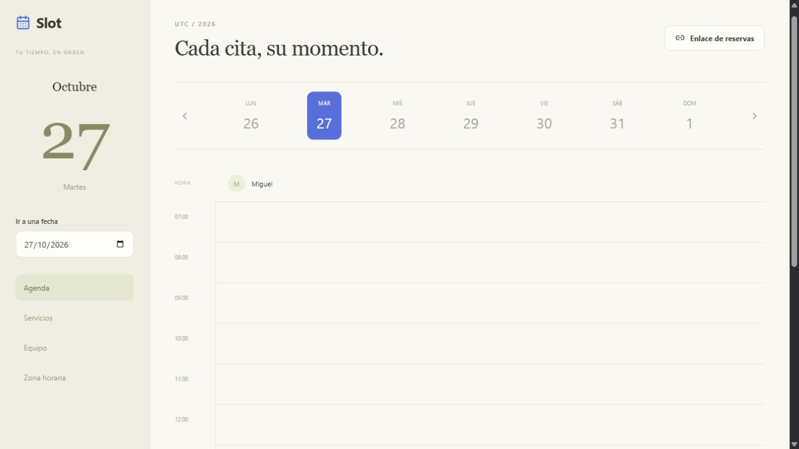

# Slot

Self-hosted appointment scheduling with timezone-aware availability and conflict-safe booking.

[](https://github.com/MIGUEL-MOSCOSO-DEV/slot/actions/workflows/ci.yml) · [Licencia MIT](LICENSE)

Una agenda de reservas para profesionales independientes y equipos pequeños. Tus clientes eligen un servicio y reservan desde un enlace.



## Qué puedes hacer

- Profesionales, servicios con duración y precio, y horarios por día de la semana.
- Zona IANA, almacenamiento UTC y tratamiento de cambios de horario de verano.
- Reservas públicas con confirmación inmediata y protección contra solapamientos.
- Cancelación mediante enlace privado y control de citas atendidas.

## Ponerlo en marcha

Necesitas Node.js 22.13 o superior y npm. Se recomienda Node 22 LTS. SQLite viene integrado en Node; no necesitas otro servicio de base de datos.

```sh
git clone https://github.com/MIGUEL-MOSCOSO-DEV/slot.git
cd slot
npm ci
npm run dev
```

Abre http://localhost:3500 y crea tu cuenta. La instalación comienza vacía: no hay usuarios, contraseñas compartidas ni registros de demostración.

Crea un profesional, define sus horarios y añade un servicio. Revisa la zona horaria antes de recibir reservas. Genera el enlace público y compártelo. Cada cliente conserva su enlace de confirmación y cancelación.

## Configuración

Puedes copiar `.env.example` a `.env`. El servidor lo lee al iniciar.

- `PORT`: puerto del servidor; 3500 por defecto.
- `HOST`: interfaz de escucha; `127.0.0.1` por defecto.
- `APP_URL`: dirección pública completa para enlaces y validación del origen.
- `DATABASE_PATH`: archivo SQLite; por defecto `./data/slot.sqlite`.

Las rutas relativas parten del directorio desde el que ejecutas el proyecto. No publiques `.env` ni los datos.

## Ejecutar en un servidor

```sh
npm ci
npm run build
npm start
```

Configura `APP_URL` con tu dominio HTTPS y coloca el proceso detrás de un proxy inverso que termine TLS. Ajusta `HOST` si tu infraestructura necesita otra interfaz. Mantén Node activo con un gestor de servicios y conserva el directorio de datos entre despliegues. La base necesita almacenamiento persistente.

Las sesiones usan cookies HTTP-only y las contraseñas se almacenan con scrypt. Las rutas privadas comprueban la cuenta propietaria y hay validación de entradas y límites de solicitudes. El registro de cuentas está abierto: quien acceda al servidor puede crear su propio espacio. No incluye recuperación de contraseña por correo ni gestión de miembros.

## Datos y copias de seguridad

Detén el proceso antes de copiar la base SQLite y sus archivos asociados, o realiza una copia coherente con herramientas de SQLite. Guarda las copias fuera de la carpeta pública y comprueba su restauración. `data/`, `.env` y las dependencias están excluidos de Git.

## Alcance actual

Una franja de trabajo por día y profesional, reservas en intervalos de 15 minutos, 30 minutos de anticipación y hasta 60 días de horizonte. Se omiten horas inexistentes o ambiguas por horario de verano. No incluye pagos, correo automático, vacaciones ni sincronización con calendarios externos. La cuenta propietaria administra todo el equipo.

## Desarrollo y pruebas

```sh
npm run check
npm run format:check
npm test
npm run build
```

Disponibilidad, horario de verano, reservas simultáneas, cancelaciones y aislamiento entre cuentas. Las pruebas crean datos temporales y los eliminan al terminar.

React construye la interfaz, Express expone la API y SQLite conserva los datos. `src/` contiene las pantallas, `server/` la lógica y persistencia, `shared/` las reglas compartidas y `tests/` las verificaciones. GitHub Actions ejecuta los controles en cada cambio de la rama principal.

## Contribuir

Abre un issue con los pasos para reproducir el error y el comportamiento esperado. No adjuntes credenciales, archivos privados ni bases de datos. Para proponer cambios, explica qué resuelven y añade pruebas cuando afecten reglas de negocio.

Creado por [Miguel Moscoso](https://github.com/MIGUEL-MOSCOSO-DEV). Licencia MIT.
